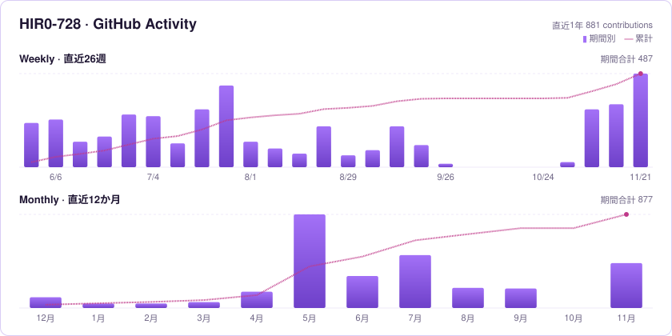

## Hi, I'm HIR0 👋

フリーランスの Web エンジニアです。バックエンドを軸に、フロントエンド、要件定義、プロダクト企画まで一貫して担当しています。

- **Backend**：Python / FastAPI、TypeScript / NestJS を中心に API 設計・開発
- **Frontend**：Next.js、Nuxt3
- **上流工程**：Biz・PdM・クライアントと連携した要件整理、仕様検討、設計
- **Product**：新規プロダクトの企画、市場調査、要件定義、開発会社との調整、受け入れテスト（PdM として）

### 💼 Experience

| 時期 | 領域 | 役割 |
|---|---|---|
| 2022 – 現在 | 教育・SaaS・モビリティ・ヘルスケア・コミュニティ領域の Web サービス開発 | バックエンド / フルスタック |
| 2024 – 現在 | 新規 to C アプリの企画・開発推進 | プロダクトマネージャー |
| 2021 – 2022 | 顔認証システム、LINE チャットボット、来店者分析の研究開発 | プロジェクトリーダー / バックエンド |
| 2017 – 2020 | PLC 機器のファームウェア開発、物体検出 AI・画像認識の研究開発 | 組込み / AI |

> Biz と開発の間に立ち、「何を作るべきか」から一緒に考えるのが得意です。

### 🛠 Tech Stack

| 分類 | 技術 |
|---|---|
| Languages | Python, TypeScript, JavaScript, C / C++ |
| Backend | FastAPI, NestJS, Django, Flask, GraphQL |
| Frontend | Next.js, Nuxt3 / Vue3, Flutter |
| Database | PostgreSQL, MySQL, MongoDB, DynamoDB |
| Cloud | AWS (Amplify Gen2, Lambda, Cognito, S3), GCP, Firebase, Docker |
| AI-assisted Dev | Claude Code, Codex, Cursor, GitHub Copilot |

### 📈 Activity

<picture>
  <source media="(prefers-color-scheme: dark)" srcset="./assets/activity-dark.svg">
  
</picture>

### 🌱 Beyond Code

写真・映像制作や SNS 運用も行っています。
いつか、IT の力で動物を助けるプロダクトをつくるのが目標です。

### 📫 Contact

